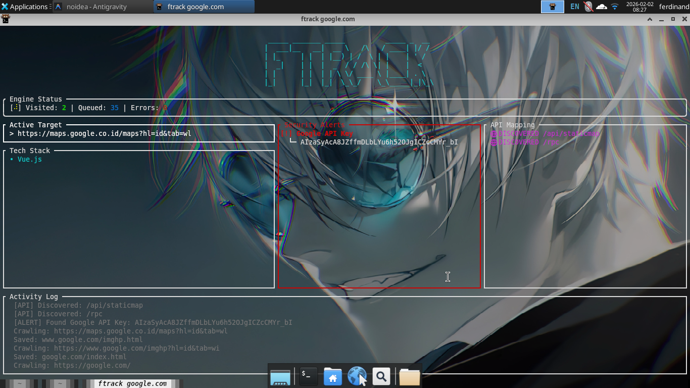
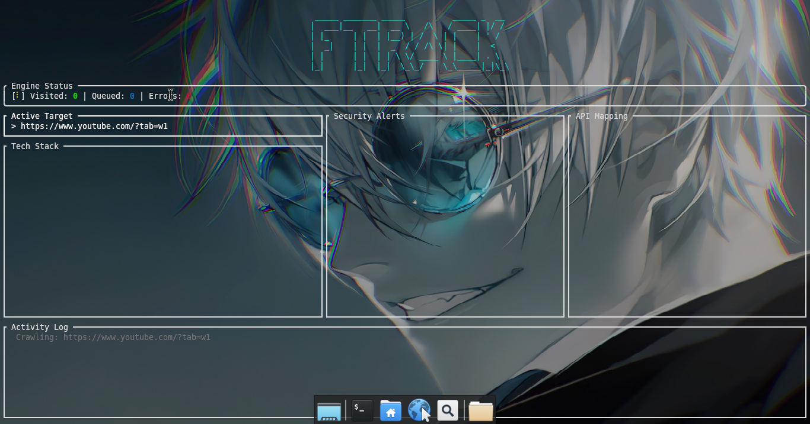

# ftrack: Industrial Web Archiver & Analyzer

<p align="center">
  
  
  
</p>

ftrack adalah kakas (tool) baris perintah berbasis Rust yang dirancang untuk kearsipan web dan analisis intelijen teknis. Proyek ini menitikberatkan pada performa tinggi, modularitas, dan kepatuhan terhadap standar industri.

## Fitur Utama

- **Kearsipan Standar**: Implementasi penuh format WARC (ISO 28500) dan ekstraksi halaman statis (Monolith).
- **Mesin Krawl**: Eksekusi asinkron menggunakan runtime Tokio dengan manajemen antrean prioritas.
- **Rendering Dinamis**: Dukungan render sisi klien (SPA) melalui integrasi Chromium headless.
- **Analisis OSINT**: 
  - Pemindaian pasif untuk deteksi kebocoran kredensial (Secret Scanner).
  - Pemetaan otomatis titik akhir (endpoint) API (REST, GraphQL, dll).
- **Antarmuka TUI**: Dasbor interaktif untuk pemantauan metrik dan aktivitas mesin secara langsung.

## Persyaratan Sistem

- Rust Stable (1.75+)
- libssl-dev / openssl
- libsqlite3-dev / sqlite
- Chromium (untuk fitur --spa)

## Instalasi

### Otomatisasi Shell
Menjalankan skrip berikut akan mengonfigurasi dependensi dan mengompilasi biner:
```bash
chmod +x install.sh
./install.sh
```

### Lingkungan Terisolasi (Docker)
ftrack dapat dijalankan di dalam kontainer untuk menghindari polusi dependensi pada sistem host:
```bash
docker build -t ftrack .
docker run -it -v $(pwd)/archive:/app/archive ftrack <URL>
```

### Instalasi Manual
```bash
cargo build --release
cargo install --path .
```

## Penggunaan

Kearsipan dasar situs web:
```bash
./ftrack https://example.com
```

Analisis teknis mendalam dengan rendering SPA:
```bash
./ftrack https://target.site --spa --analyze-api
```

### Parameter Baris Perintah
- `--output <DIR>`: Menentukan direktori keluaran.
- `--depth <N>`: Menentukan kedalaman rekursi krawl.
- `--warc`: Mengaktifkan output dalam format WARC.
- `--monolith`: Menggabungkan seluruh aset ke dalam satu file HTML.
- `--no-tui`: Menjalankan aplikasi tanpa antarmuka dasbor.

## Struktur Kode

- `src/core`: Logika inti krawler dan penjadwalan.
- `src/analyzer`: Komponen analisis teknis dan intelijen.
- `src/storage`: Implementasi berbagai lapisan persistensi data.
- `src/cli`: Penanganan argumen dan antarmuka pengguna.

## Legalitas

Pengguna bertanggung jawab penuh atas penggunaan kakas ini. Pastikan Anda memiliki otoritas untuk melakukan pemindaian pada target dan patuhi kebijakan robots.txt yang berlaku.

---
Dikembangkan oleh Tim ftrack.
