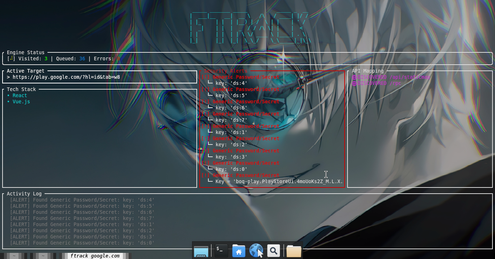
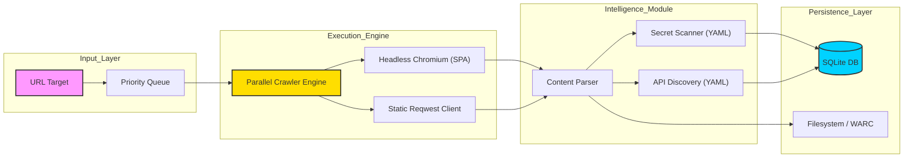

# ftrack: Industrial Web Archiver & Intelligence Engine

<p align="center">
  
  
</p>

ftrack adalah platform kearsipan web (web archiving) dan analisis intelijen sumber terbuka (OSINT) yang dikembangkan menggunakan bahasa pemrograman Rust. Kakas ini dirancang untuk memenuhi kebutuhan audit keamanan, preservasi data digital, dan pemetaan infrastruktur web dengan performa tinggi dan konkurensi paralel yang masif.

## Karakteristik Teknis

- **Parallel Execution Engine**: Memanfaatkan runtime asinkron Tokio dengan sistem `JoinSet` dan `Semaphore` untuk pemrosesan banyak URL secara simultan tanpa mengorbankan stabilitas sistem.
- **Industrial Standards Compliance**: Implementasi penuh format kearsipan ISO 28500 (WARC) untuk interoperabilitas dengan alat preservasi digital lainnya.
- **Dynamic SPA Rendering**: Integrasi mesin Chromium headless untuk mengeksekusi JavaScript pada sisi klien, memungkinkan penangkapan konten pada website berbasis Single Page Application (SPA).
- **Extensible Intelligence Logic**: Sistem deteksi berbasis YAML yang memungkinkan pembaruan pola tanda tangan (signatures) untuk rahasia (secrets) dan endpoint API secara dinamis tanpa kompilasi ulang.

## Fitur Unggulan

- **Kearsipan Mendalam**: Ekstraksi dan resolusi aset (HTML, CSS, JS, Media) untuk penggunaan luring (offline) dengan fidelitas tinggi.
- **Pemindaian Keamanan Pasif**: Deteksi kebocoran kredensial (API Keys, Tokens, Private Keys) menggunakan mesin regex berkecepatan tinggi.
- **Pemetaan API (Discovery)**: Identifikasi otomatis arsitektur API (REST, GraphQL, JSON-RPC) yang tersembunyi di dalam bundel kode front-end.
- **Persistensi Data Berbasis SQLite**: Manajemen status krawl yang inkremental, memungkinkan penghentian dan kelanjutan proses tanpa kehilangan progress.
- **Antarmuka TUI (Terminal User Interface)**: Dasbor real-time interaktif menggunakan Ratatui untuk visualisasi metrik, log aktivitas, dan temuan intelijen secara langsung.

## Instruksi Instalasi

### 1. Script Otomatis (Linux)
Gunakan skrip instalasi untuk mengonfigurasi biner dan dependensi sistem secara instan:
```bash
chmod +x install.sh
./install.sh
```

### 2. Docker (Containerized)
Untuk menjalankan ftrack dalam lingkungan terisolasi:
```bash
docker build -t ftrack .
docker run -it -v $(pwd)/archive:/app/archive ftrack <URL>
```

### 3. Kompilasi Manual
Persyaratan: Rust Stable (1.75+), OpenSSL, SQLite3, Chromium.
```bash
cargo build --release
sudo cp target/release/ftrack /usr/local/bin/
```

## Panduan Penggunaan Lengkap

### Sintaks Dasar
```bash
ftrack <TARGET_URL> [OPSI]
```

### Contoh Skenario

**Kearsipan Standar (Format lokal):**
```bash
ftrack https://example.com --depth 2 --output ./my_archive
```

**Analisis Intelijen & SPA (Deep Audit):**
```bash
ftrack https://target.app --spa --analyze-api --depth 3
```

**Kearsipan Profesional (Format WARC):**
```bash
ftrack https://government-site.gov --warc --monolith
```

### Referensi Argumen CLI

| Argumen | Alias | Deskripsi |
| :--- | :--- | :--- |
| `<URL>` | - | URL target (Protokol http/https wajib disertakan). |
| `--output` | `-o` | Jalur direktori untuk menyimpan hasil karsipan. |
| `--depth` | `-d` | Batasan kedalaman rekursi penelusuran (Default: 2). |
| `--spa` | - | Mengaktifkan rendering JavaScript (Headless Chromium). |
| `--analyze-api` | - | Menjalankan mesin pemetaan API dan pemindaian rahasia. |
| `--warc` | - | Menyimpan seluruh trafik dalam format arsip standar ISO WARC. |
| `--monolith` | - | Menggabungkan seluruh sumber daya ke dalam satu file HTML tunggal. |
| `--no-tui` | - | Menonaktifkan antarmuka grafis terminal (Mode log standar). |
| `--config` | `-c` | Menggunakan file konfigurasi `.toml` khusus. |

## Konfigurasi Lanjutan (Signatures)

ftrack menggunakan sistem tanda tangan dinamis yang berlokasi di `config/signatures/`. Anda dapat menambahkan pola deteksi baru tanpa mengubah kode sumber.

Contoh `config/signatures/custom.yaml`:
```yaml
signatures:
  - id: internal-api-key
    name: "Internal Corp API Key"
    pattern: 'CORP_[A-Z0-9]{32}'
    severity: "high"
    description: "Kunci API internal perusahaan terdeteksi."
    kind: "secret"
```

## Arsitektur & Alur Kerja Sistem

Representasi teknis mengenai bagaimana ftrack mengelola aliran data dari tahap input hingga persistensi:



## Struktur Repositori

Informasi bagi pengembang yang ingin memahami atau memodifikasi ftrack:

- `src/core`: Pengelola penjadwalan paralel, antrean prioritas, dan deduplikasi URL.
- `src/analyzer`: Implementasi deteksi teknologi, pemindai rahasia, dan parser YAML.
- `src/net`: Penanganan protokol HTTP/S, rate limiting, dan kontrol Chromium.
- `src/storage`: Backend data untuk SQLite, format WARC, dan sistem berkas lokal.
- `src/parser`: Logika ekstraksi tautan dan sumber daya dari konten mentah (HTML/JS/CSS).

## Lisensi & Kontribusi

Proyek ftrack didistribusikan di bawah Lisensi MIT. Kami menyambut kontribusi teknis melalui mekanisme:
1. **Pull Request**: Perbaikan biner, optimasi algoritma, atau fitur baru.
2. **Issue Tracking**: Pelaporan bug teknis atau saran peningkatan performa.
3. **Signatures**: Penambahan pola deteksi baru pada file konfigurasi YAML.

## Pernyataan Hukum

Penggunaan biner ftrack sepenuhnya merupakan tanggung jawab pengguna. Kakas ini dikembangkan untuk kebutuhan pertahanan keamanan dan preservasi digital. Pengguna wajib mematuhi etika krawling dan hukum privasi yang berlaku di wilayah hukum terkait.

---
© 2026 ftrack Industrial Engineering Team (FERZPEDIA)
